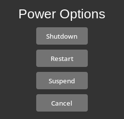

# python3-powermenu
_python3-powermenu_ is a simple python3 script for powering off, restarting, or suspending your computer, rendered in dark mode.

## Dependencies
|Dependencies|Website|
| ----------- | --- |
|python3 >= 3.6|[https://www.python.org](https://www.python.org)|
|python3-tk|[https://www.python.org](https://www.python.org)|
|systemd >= v203|[https://systemd.io/](https://systemd.io/)|
|Azure-ttk-theme|[https://github.com/rdbende/Azure-ttk-theme](https://github.com/rdbende/Azure-ttk-theme)|

For instance, the command to install these dependencies (except azure-ttk-theme) using the APT package manager would be:
`sudo apt install python3 python3-tk systemd`

For azure-ttk-theme, you can download it at [https://github.com/rdbende/Azure-ttk-theme](https://github.com/rdbende/Azure-ttk-theme). This script expects azure.tcl and the corresponding theme folder placed either in the current working directory, or in a custom directory, by passing --theme (eg. `powermenu.py --theme /home/user/.local/azure.tcl`). If this is not the case, the program will show an error and exit.

## Screenshot

## License
This program is licensed under the MIT license. To view this license, open up LICENSE or go to the following URL: [https://opensource.org/license/mit](https://opensource.org/license/mit)
