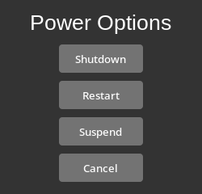
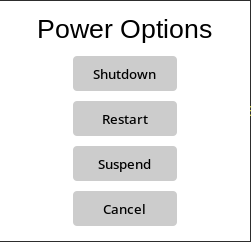

# python3-powermenu
_python3-powermenu_ is a simple python3 script for powering off, restarting, or suspending your computer.

## Dependencies
|Dependencies|Website|
| ----------- | --- |
|python3 >= 3.6|[https://www.python.org](https://www.python.org)|
|python3-tk|[https://www.python.org](https://www.python.org)|
|systemd >= v203|[https://systemd.io/](https://systemd.io/)|
|Azure-ttk-theme|[https://github.com/rdbende/Azure-ttk-theme](https://github.com/rdbende/Azure-ttk-theme)|

For instance, the command to install these dependencies (except azure-ttk-theme) using the APT package manager would be:
`sudo apt install python3 python3-tk systemd`

For azure-ttk-theme, you can download it at [https://github.com/rdbende/Azure-ttk-theme](https://github.com/rdbende/Azure-ttk-theme). This script expects azure.tcl and the corresponding theme folder placed either in the current working directory, or in a custom directory, by passing --theme (eg. `powermenu.py --theme /home/user/.local/azure.tcl`). If this is not the case, the program will show an error and exit.

A version of this theme is included in the [Releases](https://github.com/crazycatlover98544/python3-powermenu/releases) section, where it is included in the zip file.

From version 2.0 onward, _azure-ttk-theme_ is licensed under the MIT license. However, before version 2.0, it was licensed under the LGPL license. The version this program ships with is licensed under the MIT license.

## Arguments
|Argument|Explanation|
| --- | --- |
|--theme [theme]|Manually specify a theme; has to be a tcl file|
|--light|Force light mode for this session|
|--dark|Force dark mode for this session|
|--no-suspend|Remove the suspend button from the window for this session|
|--help [--no-gui]|Show the help and exit; if `--no-gui` is passed, then the help will print to the console|

## Screenshot
### Dark Mode

### Light Mode

## License
This program is licensed under the MIT license. To view this license, open up LICENSE or go to the following URL: [https://opensource.org/license/mit](https://opensource.org/license/mit)
